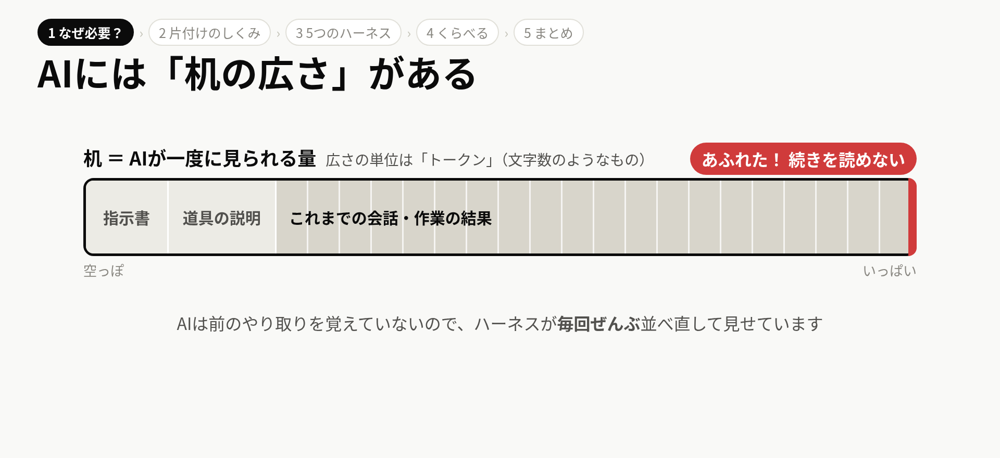
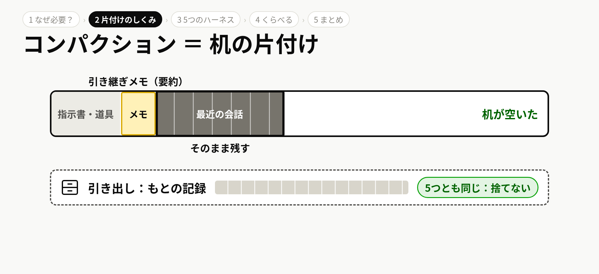
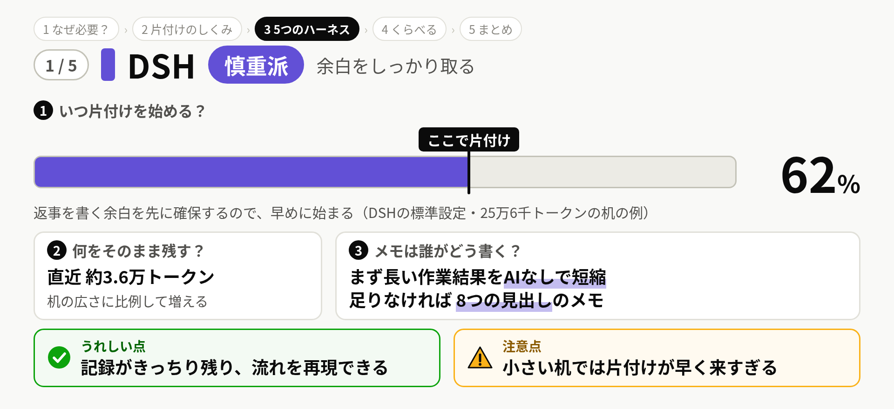
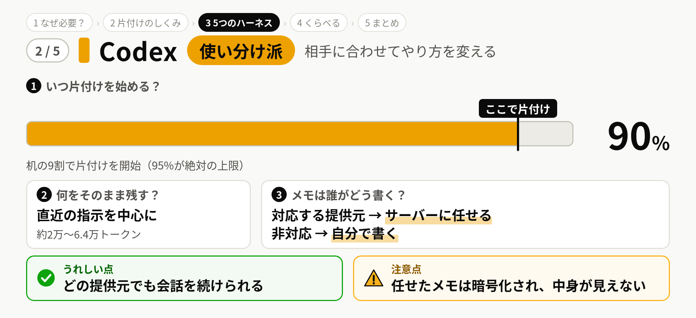
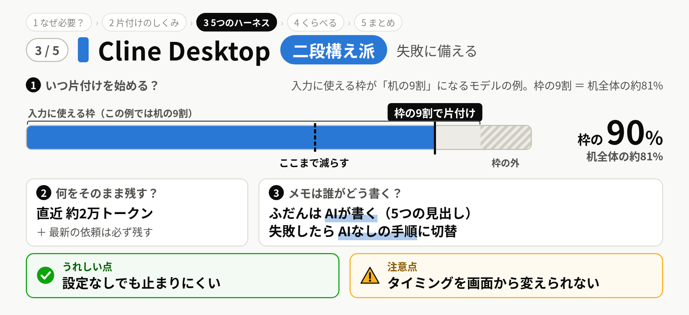
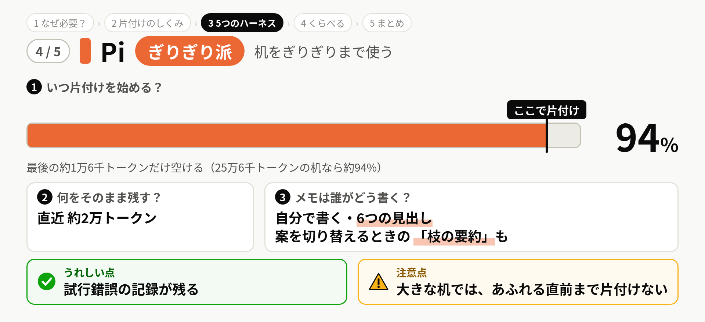
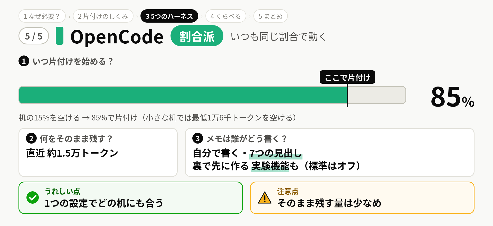
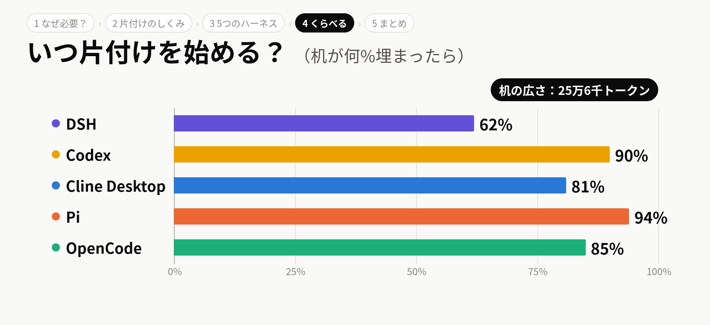
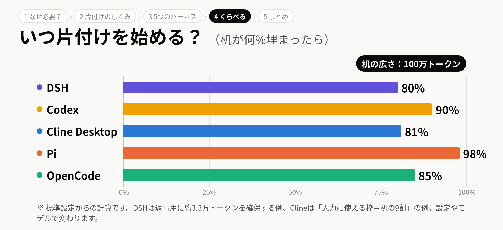

# AIの「机の片付け」— 5つのハーネスのコンパクションをやさしく

DSH / Codex / Cline Desktop / Pi / OpenCode の「コンパクション」のしくみを、前提知識なしで読めるようにまとめた解説です。
数値は、各ハーネスのソースコードにある標準設定から計算しています（2026年11月時点。確かめた版は8章）。
Claude Code については、確かめ方が違うので、9章に番外として分けて書きました。

---

## 1. 先に結論

- コンパクションは、AIの机があふれる前にする「片付け」です。
- 古い会話は「引き継ぎメモ」にまとめ、最近の会話はそのまま残し、もとの記録は捨てません。ここは5つとも同じです。
- 違うのは3点だけです。**いつ片付けを始めるか**、**何をそのまま残すか**、**メモを誰がどう書くか**。

---

## 2. そもそも何の話？

### ハーネスとは

AIモデルを「頭脳」とすると、ハーネスは頭脳に手足をつける道具です。
ファイルを読み書きする、コマンドを動かす、会話の記録を管理する、といった仕事を受け持ちます。
DSH・Codex・Cline Desktop・Pi・OpenCode は、どれもこの「ハーネス」です。

### AIには「机の広さ」がある

AIが一度に見られる量には上限があります。これを「机の広さ」にたとえます。
広さの単位は「トークン」で、文字数のようなものです。

AIは前のやり取りを覚えていません。そのためハーネスは毎回、次のものをぜんぶ机に並べ直して見せています。

- 指示書（AIへの基本的な指示）
- 道具の説明（使える機能の一覧）
- これまでの会話と、作業の結果

作業が長くなるほど机は埋まり、あふれるとAIは続きを読めなくなります。

### 古い紙を捨てるだけでは困る

古い会話から順に捨てると、次のことまで一緒に忘れてしまいます。

- なぜそう決めたか（決定とその理由）
- 何が終わったか（直したバグ、済んだ作業）
- 次に何をするか（やりかけの作業）

### コンパクション ＝ 机の片付け

そこで、次のように片付けます。

1. 古い会話を、1枚の「引き継ぎメモ」（要約）にまとめる
2. 最近の会話は、そのまま机に残す
3. もとの記録は捨てずに、引き出しにしまっておく

3 は5つのハーネスすべてに共通です。入れ替わるのは「机の上（AIに見せる部分）」だけで、記録そのものは残ります。

---

## 3. 違いは「3つの質問」で見る

| 質問 | 意味 |
|---|---|
| ① いつ片付けを始める？ | 机がどれくらい埋まったら動くか |
| ② 何をそのまま残す？ | 最近のやり取りをどれくらい残すか |
| ③ メモは誰がどう書く？ | 要約の作り手と、書き方の決まり |

---

## 4. 5つのハーネスを一言で

| ハーネス | 性格 | ① いつ始める | ② そのまま残す | ③ メモの書き方 |
|---|---|---|---|---|
| **DSH** | 慎重派 | 返事用の余白を先に確保するので早め（例：約62%） | 直近 約3.6万トークン（机の広さに比例） | まず長い作業結果をAIなしで短縮。足りなければ8つの見出しのメモ |
| **Codex** | 使い分け派 | 机の9割（95%が絶対の上限） | 直近の指示を中心に約2万〜6.4万トークン | 対応する提供元ならサーバーに任せる。非対応なら自分で書く |
| **Cline Desktop** | 二段構え派 | 入力に使える枠の9割（例：机の約81%） | 直近 約2万トークンと、最新の依頼 | ふだんはAIが書く（5つの見出し）。失敗したらAIなしの手順 |
| **Pi** | ぎりぎり派 | 最後の約1.6万トークンだけ空ける（例：約94%） | 直近 約2万トークン | 自分で書く（6つの見出し）。案を切り替えるときの「枝の要約」もある |
| **OpenCode** | 割合派 | 机の15%を空ける（85%） | 直近 約1.5万トークン | 自分で書く（7つの見出し）。裏で先に作る実験機能もある（標準はオフ） |

「例」は、机の広さが25万6千トークンで、標準設定のときの計算です。

### DSH — 慎重派

- **しくみ**: 「机の8割」と「机 − 返事用の余白 − 予備の余白」のうち、早いほうで片付けを始めます。予備の余白は標準で65,536トークンです。
- **片付けの順番**: 最初に、長すぎる作業結果（8,192文字超）をAIを使わずに短く切ります。それで足りなければ、8つの見出しが決まった引き継ぎメモをAIに書かせます。
- **うれしい点**: 片付けの開始・メモ・終了がすべて記録に残り、あとから同じ流れを再現できます。
- **注意点**: 予備の余白が大きいので、小さい机ほど片付けが早く来ます。12万8千トークンの机では、標準設定だと約23%で始まります。

### Codex — 使い分け派

- **しくみ**: 机の9割で片付けを始めます。95%は絶対に超えない上限として別に見張っています。
- **メモの書き方が3通り**: OpenAI・Azure・Bedrock・GCP など対応している提供元では、メモ作りを提供元のサーバーに任せます。対応していない提供元では、Codex が自分で要約を書きます。要約を作らずに新しい机へ移る方法もありますが、実験段階です。
- **うれしい点**: 提供元を変えても、会話を続けられます。
- **注意点**: サーバーに任せたメモは暗号化されていて、中身を確認できません。

### Cline Desktop — 二段構え派

- **しくみ**: 入力に使える枠の9割で片付けを始め、そこから7割ほどに減らします。長い会話では、条件によって枠の5割まで減らします。
- **二段構え**: ふだんはAIが5つの見出しのメモを書きます。AIの要約が失敗したときは、AIを使わない決まった手順に自動で切り替わります。机があふれた直後の復旧では、最初からこの手順を使います。
- **うれしい点**: 自動の片付けが常に有効で、何も設定しなくても止まりにくくなっています。
- **注意点**: 片付けのタイミングや残す量を、画面から変えられません。

### Pi — ぎりぎり派

- **しくみ**: 机の最後の16,384トークンだけを空けておき、そこを超えたら片付けます。空ける量が固定なので、机が大きいほど片付けは遅くなります（12万8千の机で約87%、100万の机で約98%）。
- **枝の要約**: Pi は作業を枝分かれさせて試せます。別の案に切り替えるとき、それまでの試行錯誤を要約して、移った先に持っていけます。
- **うれしい点**: 試行錯誤の記録が残ります。
- **注意点**: 大きな机では、あふれる直前まで片付けが始まりません。

### OpenCode — 割合派

- **しくみ**: 机の15%を空けておきます。机の広さに比例するので、12万8千でも100万でも85%で片付けます。机が約3万〜10万トークンのときは、最低16,000トークンを空けるため、もう少し早く始まります。
- **メモ**: 7つの見出しで書きます。片付けの時刻より前に、裏でメモを作っておく機能もありますが、実験段階で標準はオフです。
- **うれしい点**: 1つの設定で、どの広さの机にも合います。
- **注意点**: そのまま残す量が約1.5万トークンと少なめです。

### AIを使わない短縮は、具体的に何をしているか

DSH と Cline Desktop には、AIに要約を書かせずに机を空ける方法があります。やっていることは別物です。

**DSH: 長い作業結果を1件ずつ短く切る**

- **対象**: いまAIに見せている作業結果（コマンドの出力やファイルの中身など）のうち、文字数が8,192を超えるものすべて。
- **切り方**: 先頭の4,096文字と末尾の1,024文字を残し、真ん中を `[... tool result middle pruned ...]` という目印に置き換えます。画像など文字以外の部分は、そのまま残します。
- **タイミング**: 片付けを始める位置を超えたときだけ動きます。これだけで位置を下回れば、AIによる要約は行いません。足りなければ、続けてAIが引き継ぎメモを書きます。
- **もとの出力**: 記録には全文が残ります。

**Cline Desktop: 決まった規則で、残すものを選ぶ**

- ユーザーが入力した依頼は、すべて残します。添付ファイルは最新の依頼の分だけ残します。
- 最新の依頼についての作業は、新しいものから、入るだけ残します。
- 古い依頼についての作業は、最後の回答だけを残し、途中の作業は落とします。
- 落とした作業の代わりに、「読んだファイル」「編集したファイル」「実行したコマンド」の一覧を注記として残します。直近3件のAIの回答文も、この注記の中にそのまま残します。
- 一度片付けた部分は、次の片付けでまとめ直しません。

この方法が使われるのは、AIの要約が失敗したときと、机があふれた直後の復旧のときです。

| | DSH | Cline Desktop |
|---|---|---|
| 位置づけ | AIの要約の前に行う下ごしらえ | AIの要約の代わり |
| 縮める単位 | 長い作業結果1件ずつ | 会話全体 |
| 残るもの | 各出力の先頭と末尾 | 依頼の全文、最新の作業、古い回答、作業の一覧 |
| 失われるもの | 長い出力の真ん中 | 古い依頼の途中の作業の中身 |

5つすべての「AIを使わない処理」と、AIが書くメモの見出しの比較は、[引き継ぎメモの中身](compaction-summary.md)にまとめています。

---

## 5. いつ片付けが始まるか、並べてみる

机が何%埋まったら片付けを始めるかを、同じ広さの机で計算しました。

| 机の広さ | DSH | Codex | Cline Desktop | Pi | OpenCode |
|---:|---:|---:|---:|---:|---:|
| 12万8千 | 23% | 90% | 81% | 87% | 85% |
| 20万 | 51% | 90% | 81% | 92% | 85% |
| 25万6千 | 62% | 90% | 81% | 94% | 85% |
| 100万 | 80% | 90% | 81% | 98% | 85% |

読み取れること:

- **DSH** は小さい机ほど早く、大きい机でも80%が上限です。
- **Pi** は机が大きいほど遅くなります。
- **Codex・Cline・OpenCode** は、机の広さが変わっても同じ割合です。

この表は標準設定からの計算で、実際に動かして測った値ではありません。前提は次のとおりです。

- DSH は、返事用の余白が32,768トークン、予備の余白が標準の65,536トークンの場合です。
- Cline は、入力に使える枠が「机の9割」になるモデルの場合です。枠が別に登録されているモデルでは、その枠の9割になります。

---

## 6. DSH の割合は、机の広さと余白で変わる

5章の表の「62%」は、DSH の標準設定で計算した一例です。
DSH の標準設定が決めているのは割合ではなく式なので、机の広さと返事用の余白によって割合が変わります。

片付け開始 ＝「机 × 0.8」と「机 − 返事用の余白 − 予備の余白」の小さいほう（予備の余白の標準は 65,536）

| 条件 | 机の広さ | 返事用の余白 | 予備の余白 | 片付けを始める位置 |
|---|---:|---:|---:|---:|
| 標準設定（5章の表の例） | 256,000 | 32,768 | 65,536 | 157,696（約62%） |
| 標準設定で、返事用の余白が大きいモデル | 262,144 | 65,536 | 65,536 | 131,072（50%） |
| 上と同じモデルで、予備の余白を小さくした場合 | 262,144 | 65,536 | 16,384 | 180,224（約69%） |

予備の余白は、設定の `headroomTokens` で変えられます。標準のままでは片付けが早すぎるときは、ここを小さくします。

---

## 7. 用語の対応

英語の資料やソースコードを読むときの、言い換え表です。

| 資料やソースコードでの言葉 | このページでの言い方 | 意味 |
|---|---|---|
| compaction（コンパクション） | 片付け | 古い会話を要約に置き換えて、机を空けること |
| context window | 机の広さ | AIが一度に見られる量の上限 |
| token（トークン） | 広さの単位 | 文字数のようなもの |
| trigger、threshold | 片付けを始めるタイミング | |
| keep、retain、tail | そのまま残すぶん | |
| summary、checkpoint | 引き継ぎメモ | 古い会話の要約 |
| canonical transcript、session log、rollout | もとの記録（引き出し） | 捨てずに保存してある会話の全文 |
| projection、surface | 机の上 | AIに実際に見せる部分 |
| provider | AIの提供元 | OpenAI など |
| provider-native、remote | 提供元のサーバーに任せる | メモ作りを提供元の側で行うこと |
| reserve、headroom、buffer | 余白 | 返事を書くために空けておく場所 |
| overflow | 机があふれること | |
| tool result、tool pair | 作業の結果 | 「頼んだ記録」と「結果」は2枚1組で、片方だけ残せない |
| pruner | 長い作業結果を短く切るしくみ | AIを使わない |
| fallback | 予備の方法 | うまくいかないときに切り替える先 |
| branch summary | 枝の要約 | Pi で、案を切り替えるときに作る要約 |

---

## 8. 数値の根拠

数値は、次の版のソースコードにある標準設定の値と式から計算しました。
実際にハーネスを動かして測った値ではありません。設定やモデルによって変わります。

| ハーネス | 確かめた版 | 主な場所 |
|---|---|---|
| DSH | `@deepseek-ai/dsh-compaction-basic` 0.2.2-rc.1、`@deepseek-ai/dsh-compaction-tool-result-pruner` 0.2.2-rc.1 | `lib/index.js` |
| Codex | [openai/codex](https://github.com/openai/codex) `69231e1` | `codex-rs/protocol/src/openai_models.rs`、`codex-rs/core/src/compact.rs`、`codex-rs/core/src/compact_remote_v2.rs` |
| Cline Desktop | [cline/cline](https://github.com/cline/cline) `72b3d71` | `sdk/packages/core/src/extensions/context/` の `compaction-shared.ts`、`compaction.ts`、`basic-compaction.ts` |
| Pi | [earendil-works/pi](https://github.com/earendil-works/pi) `827383a` | `packages/coding-agent/src/core/compaction/compaction.ts` |
| OpenCode | [anomalyco/opencode](https://github.com/anomalyco/opencode) `83960f8` | `packages/core/src/session/compaction.ts` |

確かめた標準設定の値は次のとおりです。

| ハーネス | 標準設定の値 |
|---|---|
| DSH | 片付け開始 = min(机 × 0.8, 机 − 返事用の余白 − 65,536)。そのまま残す量 = (机 − 返事用の余白) × 0.16。メモの見出しは8つ。長い作業結果は、8,192文字を超えると先頭4,096文字と末尾1,024文字に短縮 |
| Codex | 片付け開始 = 机 × 9/10。入力の上限は95%。そのまま残す量は、自分で書く場合が20,000、提供元に任せる場合が64,000 |
| Cline Desktop | 入力に使える枠 = 机 × 0.9（枠が登録されていないモデルの場合）。片付け開始 = 枠 × 0.9。減らす目標は0.7（長い会話は0.5）。そのまま残す量は20,000 |
| Pi | 空ける量は16,384。そのまま残す量は20,000。メモの見出しは6つ |
| OpenCode | 空ける割合は0.15、最低16,000。そのまま残す量は15,000。メモの見出しは7つ。裏で先にメモを作る機能は標準でオフ |

---

## 9. 番外：Claude Code の場合

Claude Code も同じ「ハーネス」ですが、ソースコードが公開されていません。そのため、上の5つとは確かめ方が違います。

- **公式の資料**: Claude Code の公式ドキュメント、変更履歴、Anthropic のブログ（2026年11月時点）
- **実際の記録**: 手元の Claude Code のセッション記録にあった、片付けの記録65件（Claude Code 2.1.222〜2.1.325）

確かさが違うので、5章の表には混ぜず、ここに分けて書きます。引き継ぎメモの見出しは、[続きの記事の7章](compaction-summary.md#7-番外claude-code-の引き継ぎメモ)にあります。

### 3つの質問で見る

| 質問 | Claude Code |
|---|---|
| ① いつ片付けを始める？ | 割合ではなく、トークン数で決まる。100万トークンの机では約96.7万（約97%）。20万トークンの机では「20万の境目」。席を離れているあいだに片付けるしくみもある |
| ② 何をそのまま残す？ | 直近のメッセージを数件。会話の残りは引き継ぎメモに置き換える。指示書（CLAUDE.md）は読み込み直し、直近に触ったファイルを5つまで読み直す |
| ③ メモは誰がどう書く？ | AIが書く。もとの会話の最後に「要約の指示」を足して頼む。メモの見出しは9つ。メモとは別に、古い作業結果を消すしくみもある |

### ① いつ片付けを始めるか

公式ドキュメントは、割合ではなくトークン数で説明しています。

- **何も設定しない場合**: 会話がモデルの机の上限に達したときに片付けます。
- **100万トークンの机で動くモデル**: 机が埋まる前に、標準で約96.7万トークンで片付けます。
- **20万トークンの机で動くモデル**: 「20万の境目」で片付けます。
- **変更履歴にある変化**: Sonnet 5 の開始位置は、以前は約93.4万でした。版によって変わります。

実際の記録（65件）では、次のようになっていました。

| 記録の種類 | 件数 | 片付け直前のトークン数 |
|---|---:|---|
| 20万の机として動いていたとみられるもの | 11 | 166,747〜168,929（約84%） |
| 100万の机で動いていたもの | 16 | うち11件が 966,961〜971,587（約97%）。5件は97.5万以上 |
| 席を離れているあいだの片付けとみられるもの | 34 | 20万〜96万のあいだのさまざまな位置 |
| そのほか | 4 | 17万〜96万のあいだ |

- 100万の机の記録は、公式の「約96.7万」と合っています。
- 20万の机の記録は、「20万の境目」より約3.3万トークン手前でした。この差の内訳は、公式の資料では確かめられませんでした。
- 「席を離れているあいだの片付けとみられるもの」は、片付けにかかった時間が数十ミリ秒と短い記録です。あらかじめ書かれたメモを使ったと考えると合いますが、記録の印からの推測です。

**席を離れているあいだの片付け（idle compaction）**

ほかの5つでは見つからなかったしくみです。条件がそろうと、ユーザーが何もしなくても片付けます。主な条件は次のとおりです。

- 会話が20万トークン以上ある（標準の値。変えられます）
- 最後のやり取りから約1時間たっている（変更履歴では「約54分」）
- 自動の片付けが有効になっている

理由は費用です。AIの提供元は、同じ書き出しの依頼を安く速く処理する「キャッシュ」を一定時間だけ保ちます。その期限が切れる前に片付けておくと、次のメッセージで長い会話を処理し直さずに済みます。

**開始位置を変える方法**

| 方法 | できること |
|---|---|
| `/autocompact 500k` のようなコマンド | 開始位置をトークン数で指定する（10万〜100万）。いまのモデルの設定として保存される |
| 設定ファイルの `autoCompactWindow` | すべてのモデルの開始位置を指定する |
| 環境変数 `CLAUDE_CODE_AUTO_COMPACT_WINDOW` | 上の2つより優先して、開始位置を指定する |
| 環境変数 `CLAUDE_AUTOCOMPACT_PCT_OVERRIDE` | 開始位置を割合（1〜100）で早める。遅らせることはできない |
| 設定 `autoCompactEnabled`、環境変数 `DISABLE_AUTO_COMPACT` | 自動の片付けを止める。手動の `/compact` は使える |
| 設定 `idleCompaction` | 席を離れているあいだの片付けだけを止める |

### ② 何をそのまま残すか

会話の履歴は、引き継ぎメモに置き換わります。そのうえで、次のものが机に戻ります。

| もの | 片付けのあと |
|---|---|
| 直近のメッセージ | 数件をそのまま残す（実際の記録では4〜22件、中央値6件） |
| 指示書（プロジェクトのルートの CLAUDE.md）と自動メモ | ディスクから読み込み直す |
| 読んだファイル、編集したファイル | 更新が新しい順に5つまで読み直す。5,000トークンを超えるファイルは、場所だけを戻す |
| 呼び出したスキルの本文 | 1つ5,000トークン、合計25,000トークンまで戻す。古いものから落とす |
| 下の階層の CLAUDE.md、場所を限ったルール | メモに要約されて消える。そのファイルに次に触れたとき、読み込み直す |
| フックが途中で足した内容 | 会話と一緒に要約される |
| もとの記録 | セッションの記録に全文が残る。メモの末尾に、その場所が書かれる |

片付けのあとの机の使用量は、実際の記録で約8千〜2万5千トークン（中央値 約1万8千）でした。メモのほか、読み直したファイルなども含む量です。

### ③ メモは誰がどう書くか

- **書き手**: 公式の資料は、モデルの名前を書いていません。ただ、会話と同じ書き出しでキャッシュを使い回す頼み方なので、会話と同じモデルが書くと読めます。公式ドキュメントは、片付けのときに、机がより小さいモデルへは切り替えないとも書いています。
- **頼み方**: もとの会話と同じ指示書・道具の説明・履歴を並べ、最後に「要約の指示」を足して頼みます。キャッシュがそのまま使えるので、長い会話でも費用が抑えられます。
- **余白**: この頼み方では、要約の依頼そのものが机いっぱいの大きさになります。そのため、指示とメモの出力を入れる余白を、あらかじめ空けてあります。
- **見出し**: 9つです。[続きの記事の7章](compaction-summary.md#7-番外claude-code-の引き継ぎメモ)で、DSH の8つと並べています。
- **メモへの注文**: `/compact` に「何を残すか」を添えるか、CLAUDE.md に書いておくと、メモに反映されます。

**メモを使わずに机を空けるしくみ**

Claude Code には、メモを書かずに、古い作業結果を机から消すしくみもあります。公式ドキュメントには、このしくみがあることだけが書かれています。いつ、どれだけ消すかは書かれていません。
利用者の報告では、消された作業結果は「消した」という短い印に置き換わり、片付けの通知は出ません。

### 5つと比べると

机が何%埋まったら片付けを始めるかを、5章の表に並べます。

| 机の広さ | DSH | Codex | Cline Desktop | Pi | OpenCode | Claude Code |
|---:|---:|---:|---:|---:|---:|---:|
| 20万 | 51% | 90% | 81% | 92% | 85% | 約84%（実際の記録） |
| 100万 | 80% | 90% | 81% | 98% | 85% | 約97%（公式） |

- **開始は遅め**: 100万の机では、Pi の次に遅い位置です。早めたいときは、自分でトークン数を指定します。
- **頼み方は DSH・Codex・OpenCode と同じ型**: 会話をそのまま送って、最後に指示を足します。
- **ファイルを読み直す**: ほかの5つでは、読み直す処理は見つかりませんでした。メモにファイルの一覧を書くか、足すものはあります。
- **席を離れているあいだの片付け**: ほかの5つでは見つかりませんでした。
- **古い作業結果の扱い**: DSH は長い結果の真ん中を抜きます。Claude Code は、利用者の報告によると、古い結果の中身を丸ごと短い印に置き換えます。

### 公式の資料が書いている注意点

- メモは依頼と主なコードを残しますが、会話の早い時期の細かい指示は、失われることがあります。ずっと守らせたい決まりは、CLAUDE.md に書きます。
- 作業がこの先どちらへ向かうかをAIが予測できないと、メモの出来が悪くなることがあります。
- 大きなファイルや出力が、片付けの直後に机を埋め直すことが続くと、自動の片付けは止まり、エラーが表示されます。

### この章の根拠

| 内容 | 資料 |
|---|---|
| 開始位置と、変える方法 | [Model configuration](https://code.claude.com/docs/en/model-config#context-window-and-auto-compaction)、[Environment variables](https://code.claude.com/docs/en/env-vars) |
| 片付けのあとに残るもの | [Explore the context window](https://code.claude.com/docs/en/context-window#what-survives-compaction) |
| 席を離れているあいだの片付け | [All settings の idleCompaction](https://code.claude.com/docs/en/settings-reference#idlecompaction)、[変更履歴](https://github.com/anthropics/claude-code/blob/main/CHANGELOG.md) |
| メモの頼み方と余白 | [How Claude Code uses prompt caching](https://code.claude.com/docs/en/prompt-caching#compacting-the-conversation)、[Lessons from building Claude Code: Prompt caching is everything](https://claude.com/blog/lessons-from-building-claude-code-prompt-caching-is-everything) |
| 古い作業結果を消すしくみがあること | [Manage costs effectively](https://code.claude.com/docs/en/costs)。利用者の報告は [anthropics/claude-code の issue 42542](https://github.com/anthropics/claude-code/issues/42542) |
| 注意点 | [How Claude Code works](https://code.claude.com/docs/en/how-claude-code-works#when-context-fills-up)、[Using Claude Code: session management and 1M context](https://claude.com/blog/using-claude-code-session-management-and-1m-context)、[Troubleshooting](https://code.claude.com/docs/en/troubleshooting) |
| 実際の記録 | 手元のセッション記録にある片付けの記録65件を数えたもの。1つの環境での記録で、設定やモデルが違えば変わります |

公式に書かれていないので、確かめられなかったことは次のとおりです。

- 古い作業結果を、いつ、どれだけ消すか
- 20万の机の開始位置が「20万の境目」より約3.3万手前になる理由
- 要約の指示文の全文（公開されていません。見出しは、実際のメモに現れるものを数えました）
